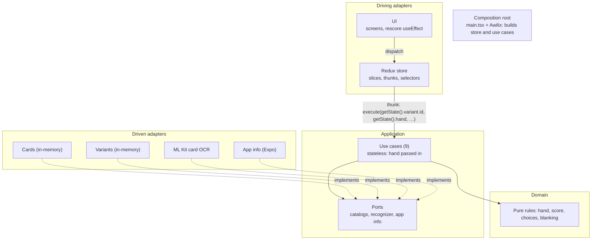
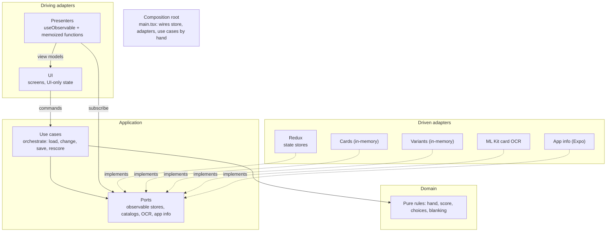

# Architecture rethink: moving orchestration into the core

A brief for the next stage of work on Realms Scorer. It records how the app is structured today, what we found, the structure we want to move to, and the open questions. Read it before planning or making changes to `src/infrastructure/driving/state/`, `src/application/` or `src/composition-root.ts`.

## Guiding principle

Treat the app as one hexagonal application, not a front end talking to a back end. Whether an adapter runs on the phone or on a server is an implementation detail. The UI is one driving adapter among possibly several; the Redux store is one driven adapter that holds state and tells subscribers when it changes.

In short: **the application decides what happens; Redux only remembers it and pushes changes to the UI.**

## Current architecture



How an action flows today:

1. A component dispatches a thunk, such as `addCardToHand(cardId)`.
2. The thunk reads the variant and hand from Redux and passes them to a stateless use case through `thunk.extraArgument`.
3. The use case returns a new `Hand`; `extraReducers` stores it.
4. `Screens.tsx` has a `useEffect` on the hand that dispatches `scoreHand()`.
5. Other slices react to the thunks' lifecycle actions: `navigation-slice` closes the choice sheet on `removeCardFromHand.fulfilled`, and `scan-slice` tracks `replaceHand.pending/fulfilled/rejected`.
6. About 615 lines of `createSelector` selectors turn state into view models.

### What's good, and should be kept

- ESLint enforces the dependency boundaries, including `import type`-only use of the domain from infrastructure and keeping React, Redux and Awilix out of the core.
- The domain is pure functions on plain data.
- Each use case declares its own ports, and there's a single composition root.
- Component tests drive the real UI and store with fake use cases.

### Problems found

- **Orchestration lives outside the core.** The thunks, and the rescoring `useEffect` in the UI, decide the sequence of a change ("add the card, store the hand, rescore"). That's application behaviour sitting in driving adapters.
- **Redux is the application's only state holder.** Use cases have to be handed the hand and variant on every call, so the store is effectively the application. That's why swapping state libraries looks so costly.
- **Behaviour can't be tested without Redux and React.** "Adding a card rescores the hand" needs the store and the component wiring.
- **Every new entry point would repeat the orchestration.** A widget, a deep link or a web build would re-implement what the thunks and the `useEffect` do.
- **Ceremony.** Awilix wires 9 use cases and 4 adapters that hand-written `new` calls would cover in about 20 lines. Trivial use cases like `ClearHandUseCase` still get an interface, a class and an async thunk. `hand-rules.ts` restates the catalog port types.
- **Presenter logic is tied to Redux.** The selectors are display logic (wording, sorting, warnings), which belongs in the driving layer, but as `createSelector` chains on `RootState` they can't be reused with another store.

## Target architecture



What changes:

- **Redux becomes a driven adapter.** It implements observable store ports such as `HandStore` and `ScoreStore`. Nothing outside its folder imports Redux.
- **The UI has two paths through the core.** Commands go to the use cases; reads come back from the store ports, through presenters.
- **The use cases orchestrate.** Each one loads what it needs, changes it with the domain, saves it and triggers a rescore. Thunks and the rescoring `useEffect` go away.
- **Presenters replace the selectors** as plain, memoized functions.
- **UI-only state stays in the driving layer.**
- **The composition root wires everything by hand**, without Awilix.

## Key design decisions

### 1. Application state and UI state are different

| Application state (behind ports)  | UI-only state (driving layer)           |
| --------------------------------- | --------------------------------------- |
| Hand (cards and choices)          | Current screen                          |
| Selected variant                  | Open sheets and the card picked in them |
| Latest score                      | Card to scroll to and reveal            |
| Scan session (see open questions) | In-flight and failure flags for buttons |

Putting UI state behind application ports would fill the core with presentation concerns. The line should be deliberate, not accidental.

### 2. An application-owned `Observable` port

The UI needs changes pushed to it, so the ports are shaped like React's `useSyncExternalStore` contract, without depending on React:

```ts
// src/application/observable.ts
export type Unsubscribe = () => void;

export interface Observable<T> {
  get(): T;
  subscribe(listener: () => void): Unsubscribe;
}

export interface HandStore extends Observable<Hand> {
  save(hand: Hand): void;
}

export interface ScoreStore extends Observable<HandScore | null> {
  save(score: HandScore | null): void;
}

export interface CurrentVariant extends Observable<VariantId> {
  save(variantId: VariantId): void;
}
```

Use cases depend on `get` and `save`; the UI depends on `get` and `subscribe`. Both use the application's types only.

`get` is synchronous, matching Redux's `getState`. If real persistence (AsyncStorage) is added, load it at startup and keep these synchronous. Ports for anything plausibly remote (catalogs, a future AWS backend) stay asynchronous and allowed to fail.

### 3. Use cases run the whole change

```ts
class AddCardToHandUseCase {
  constructor(private readonly ports: AddCardToHandPorts) {}

  async execute(cardId: CardId): Promise<void> {
    const { hands, variant, variantCatalog, rescore } = this.ports;
    const { handSize } = await variantCatalog.getById(variant.get());
    const hand = await withValidChoices(
      this.ports,
      variant.get(),
      addCardToHand(hands.get(), cardId, handSize),
    );

    hands.save(hand);
    await rescore.execute();
  }
}
```

`RescoreUseCase` replaces the `useEffect`, and the other use cases call it. It also takes over the late-result protection that `requestId` gives the thunks today: it remembers the hand it started from and skips saving the score if `hands.get()` has changed in the meantime.

### 4. The Redux adapter

```ts
// src/infrastructure/driven/redux-state/observe.ts
function observe<T>(store: AppStore, select: (s: RootState) => T) {
  return {
    get: () => select(store.getState()),
    subscribe: (listener: () => void) => {
      let last = select(store.getState());
      return store.subscribe(() => {
        const next = select(store.getState());
        if (next !== last) {
          last = next;
          listener();
        }
      });
    },
  };
}

export function reduxHandStore(store: AppStore) {
  return {
    ...observe(store, (s) => s.hand),
    save: (hand: Hand) => store.dispatch(handSaved(hand)),
  };
}
```

- Slices become simple setters: `handSaved`, `scoreSaved`, `variantSaved`.
- The adapter satisfies the ports structurally, without `implements`, as the other driven adapters do. That also keeps `driven` free of `application` imports.
- Redux notifies after every dispatch; the reference check means listeners only hear about their own part of the state. This relies on Redux's immutable updates.
- Keep the existing note about Immer drafts and readonly arrays: the setters return the payload as the new state.

### 5. Presenters and a generic hook

```ts
// src/infrastructure/driving/ui/useObservable.ts
export function useObservable<T>(source: Observable<T>): T {
  return useSyncExternalStore(source.subscribe, source.get);
}
```

- The current selectors become plain presenter functions, such as `presentCardSections(cards, hand, variant)`, memoized with `useMemo` or standalone reselect (which doesn't need Redux).
- Components get the stores and use cases from React context, provided by the composition root.
- `react-redux` is no longer needed.

Two rules `useSyncExternalStore` depends on:

- `subscribe` and `get` must be stable functions, built once in the adapter, or React resubscribes on every render.
- `get` must return the same object until something changes, or React re-renders forever. Any hand-written adapter must guarantee this too.

### 6. Wiring by hand

```ts
// src/composition-root.ts
const store = createAppStore();
const hands = reduxHandStore(store);
const scores = reduxScoreStore(store);
const variant = reduxCurrentVariant(store);
const cardCatalog = new InMemoryCardCatalog();
const variantCatalog = new InMemoryVariantCatalog();

const rescore = new RescoreUseCase({
  hands,
  scores,
  variant,
  cardCatalog,
  variantCatalog,
});
const useCases = {
  addCardToHand: new AddCardToHandUseCase({
    hands,
    variant,
    cardCatalog,
    variantCatalog,
    rescore,
  }),
  // …
};

export const app = { useCases, stores: { hands, scores, variant } };
```

The compiler checks every dependency, and the store no longer needs `thunk.extraArgument`, which removes the store ↔ use cases circular dependency.

### 7. Testing

- **Use-case tests** use an `InMemoryStore<T>` (a value, a set of listeners and `save`) and can cover whole flows, such as "adding a card saves the hand and updates the score", with no Redux or React.
- **Adapter tests** cover `observe` and the setters: a few tests, not the current ~1,500-line `store.test.ts`.
- **Presenter tests** call plain functions with plain data.
- **Component tests** stay as they are in spirit: real components with fake or in-memory adapters.

## Things the new design must handle explicitly

- **Overlapping changes.** With load → change → save around `await`s, two quick taps or a slow rescore can overwrite each other. Choose one approach: run hand-changing use cases one at a time (a simple queue), check a hand version before saving, or at least use the "skip if the hand changed" check in rescoring.
- **Lifecycle flags.** `createAsyncThunk` currently provides pending, fulfilled and rejected for free. In the new design, flags like `confirming` and `confirmFailed` come from the promise a use case returns, held in component state or a small UI slice.
- **Cross-cutting reactions.** "Close the choice sheet when its card leaves the hand" becomes UI logic reacting to the hand observable, not a reducer matching another slice's action.
- **Remote adapters behave differently.** The structure shouldn't care where an adapter runs, but latency, failure and staleness will differ. Keep plausibly remote ports asynchronous and allowed to fail.

## Open questions

1. **Where does the scan session live?** Recognising → review with picks → confirming is a real workflow. The current lean is to make it application state behind a `ScanSessionStore`, with a `ConfirmScanUseCase` that replaces the hand and clears the session. The picks while reviewing could arguably be UI-only state.
2. **Where does UI-only state live?** Either keep it in Redux slices exposed through the same `Observable` pattern, or move it to React state and context. Either way, the UI shouldn't import Redux.
3. **Is Redux still worth it?** Once it only holds state and notifies, its main features (actions as events, reducer logic, devtools) are mostly unused. Vanilla Zustand or a small hand-written observable store would also work, and only the adapter folder would change. Deciding can wait until after the migration.
4. **Combining sources.** Do presenters call one hook per store plus `useMemo`, or is a `combine(a, b, …)` helper worth adding?
5. **Card catalog data.** Should the card list also be an observable store, or stay a catalog port that presenters read once?

## Suggested migration order

Each step should leave the app working and the tests passing.

1. Add `Observable`, the store ports and `InMemoryStore<T>`, with tests.
2. Add the Redux adapter (`observe` and the setter slices) alongside the existing slices.
3. Add `RescoreUseCase` with the stale-result check, and move one hand use case (say, `addCardToHand`) to load, change, save and rescore.
4. Switch that action's UI to call the use case through context and read the hand through `useObservable`; delete its thunk. Repeat for the other hand actions, then remove the rescoring `useEffect`.
5. Convert the selectors into presenter functions, a group at a time.
6. Move the scan flow, once the scan-session question is settled.
7. Replace Awilix with hand wiring; remove `react-redux` and `thunk.extraArgument`.
8. Update the ESLint zones: allow `@reduxjs/toolkit` only in the Redux adapter folder, and adjust the `state/` rules.
9. Update the architecture section of `CLAUDE.md` to match.

## Alternatives considered

- **Keep Redux Toolkit as is, with `create.asyncThunk` in slices.** This puts each thunk next to its reducers and shrinks the slices by perhaps 20–30%, but it doesn't move orchestration into the core.
- **Replace Redux with Zustand.** Simpler code in the state layer, but the async handling, late-result protection and cross-slice reactions would all be written by hand, and orchestration would still sit outside the core.
- **MobX view-model classes.** A good fit for injected ports, and its cached getters would replace the selector wiring, at the cost of mutable state and `observer` wrappers.
- **Repository instead of Redux.** The point isn't replacing Redux but moving the orchestration inward. A Redux-backed repository is a valid adapter, which led to this design.
